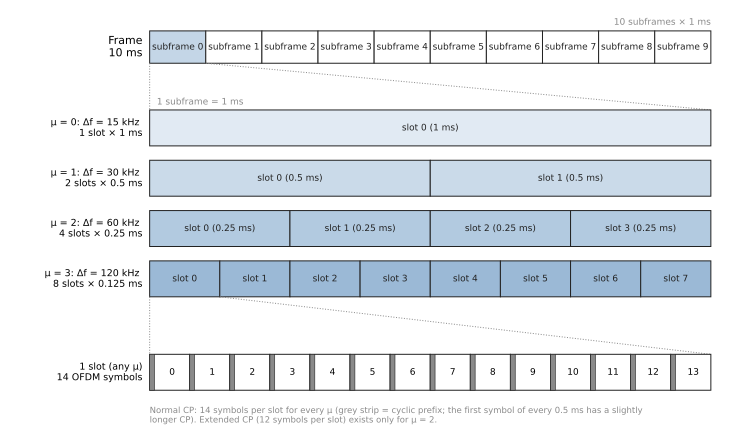
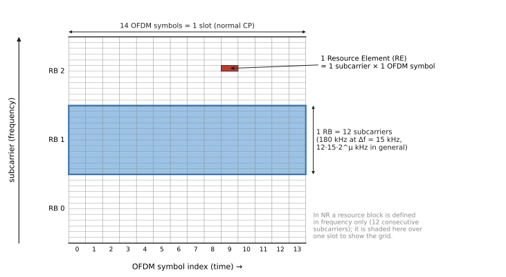
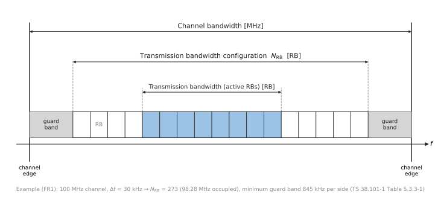
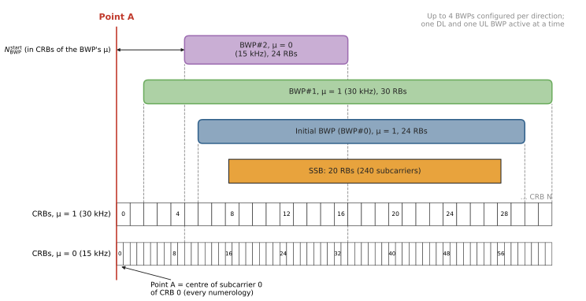
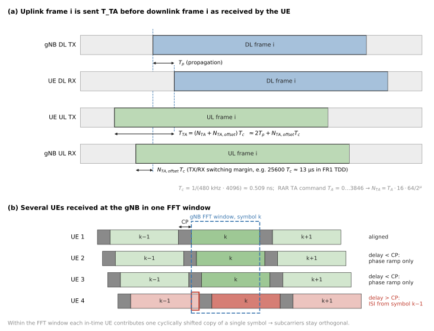
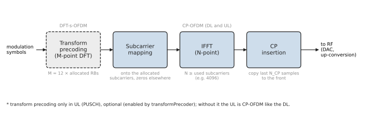
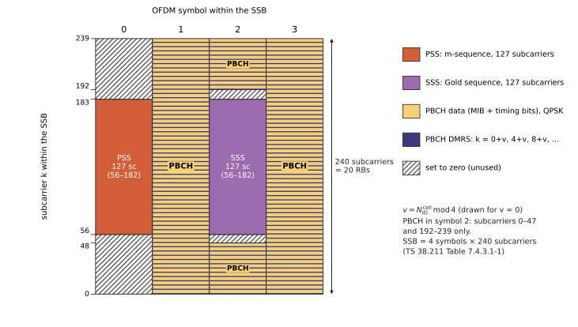
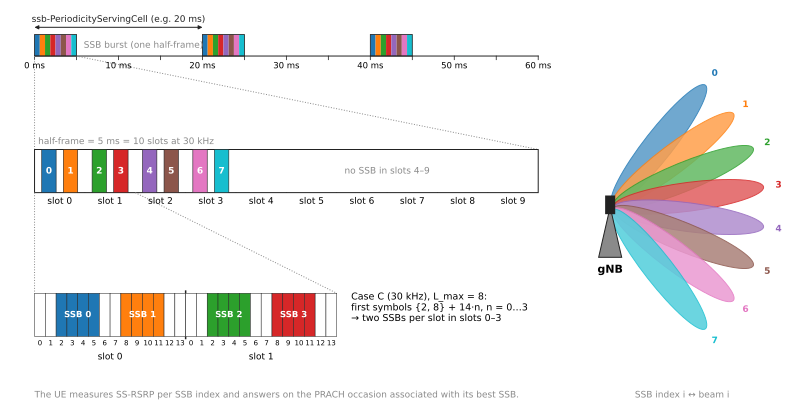
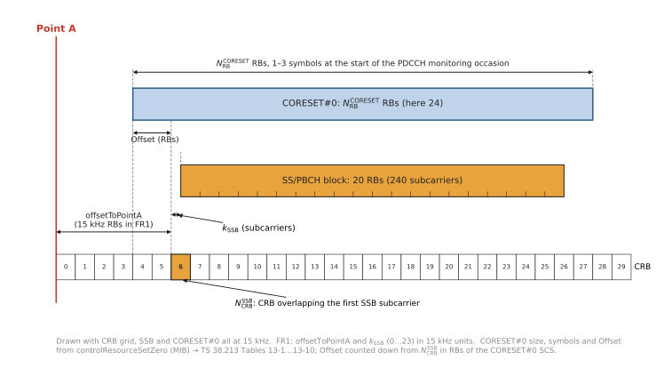
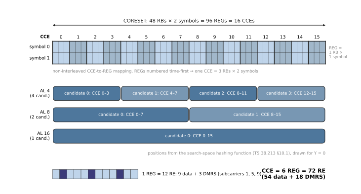

# Mobile Communication Systems (MobSys)

### Lecture 1 — 5G NR physical layer basics and initial access

Raymond Knopp, EURECOM

---

## Outline of basic 5G (and a bit of 4G) procedures

- Visit the procedures via the connection of a call from the perspective of the UE (User Equipment)
- Basic exchanges at the physical layer
  - Synchronization and broadcast channels
  - Random access
- Steady-state procedures
  - Downlink: Downlink Control Information (DCI) for scheduling control, downlink data transmission
  - Uplink: Uplink Control Information (UCI) for feedback, uplink data transmission

---

## What we will learn

- The time-frequency grid and 5G numerologies
- The notion of physical channels
- The roles of the different channels in the establishment and maintenance of a connection to the network

---

## Basic terms

- **gNodeB / gNB** = base station
- **UE** = User Equipment (terminal)
- **DL** = Downlink (gNB → UE)
- **UL** = Uplink (UE → gNB)

---

## Frames, subframes, slots
<!-- NEW: review -->

- Time is organised in **frames** of 10 ms, numbered by the System Frame Number (SFN, 0…1023)
- Each frame = 2 **half-frames** of 5 ms = 10 **subframes** of 1 ms
- Each subframe contains $2^\mu$ **slots**, where $\mu$ is the numerology
- A slot is **14 OFDM symbols** (normal cyclic prefix) or 12 symbols (extended cyclic prefix, only for $\mu=2$)
- The subframe (1 ms) is the same for all numerologies; the slot shrinks as the subcarrier spacing grows
- Scheduling is done per slot (or per group of symbols inside a slot, "mini-slots")

---

## Subcarrier Spacing (SCS)
<!-- NEW: review -->

Numerology $\mu$: $\Delta f = 2^\mu \cdot 15$ kHz (TS 38.211 Table 4.2-1, Table 4.3.2-1)

| $\mu$ | $\Delta f$ (kHz) | Slots / subframe | Slots / frame | Slot duration | Typical use |
|---|---|---|---|---|---|
| 0 | 15 | 1 | 10 | 1 ms | FR1 (LTE-like) |
| 1 | 30 | 2 | 20 | 0.5 ms | FR1 (e.g. Band n78) |
| 2 | 60 | 4 | 40 | 0.25 ms | FR1/FR2 (normal or extended CP) |
| 3 | 120 | 8 | 80 | 125 µs | FR2 |
| 4 | 240 | 16 | 160 | 62.5 µs | FR2, SSB only (Rel-15) |

- Rel-17 adds $\mu=5,6$ (480/960 kHz) for 52.6–71 GHz
- Larger SCS = shorter symbols and CP: less latency, more robust to phase noise/Doppler, less robust to delay spread

---

## Sub-frame and frame
<!-- CHANGED: slot duration is 0.5 ms (original said 500ms); added NR basic time unit T_c -->

- Basic time unit in NR: $T_c = 1/(\Delta f_{max} N_f)$ with $\Delta f_{max}=480$ kHz, $N_f=4096$, i.e. $T_c \approx 0.509$ ns
- LTE time unit $T_s = 1/(15\,\text{kHz}\cdot 2048) = 1/30.72$ MHz, and $\kappa = T_s/T_c = 64$
- One frame: $T_f = 10$ ms $= 307200\,T_s = 19\,660\,800\,T_c$
- One subframe: 1 ms; here $\mu=1$, so slots 0, 1, 2, 3, …, 18, 19 in a frame
- $T_{slot} = 15360\,T_s = 0.5$ ms ($\mu=1$), 14 OFDM symbols per slot
- Normal prefix: $N_{CP} = 144\kappa\,2^{-\mu}$ (plus $16\kappa$ for the first symbol of every 0.5 ms); extended prefix: $512\kappa\,2^{-\mu}$
- Useful symbol duration $N_u = 2048\kappa\,2^{-\mu}$ ($= 1/\Delta f$, e.g. 33.3 µs at 30 kHz, with CP ≈ 2.34 µs)

---

## Resource blocks
<!-- NEW: review -->

- A **resource element (RE)** $(k,l)$ = one subcarrier $k$ in one OFDM symbol $l$
- A **resource block (RB)** = 12 consecutive subcarriers in frequency (no time dimension in the definition)
- One **resource grid** per numerology and per antenna port, at most 275 RBs (3300 subcarriers)
- **Common Resource Blocks (CRB)**: numbered from 0 upwards starting at **Point A** (subcarrier 0 of CRB 0), for each numerology
- **Physical Resource Blocks (PRB)**: numbered from 0 inside a bandwidth part: $n_{CRB} = n_{PRB} + N_{BWP}^{start}$
- RB bandwidth: 180 kHz at 15 kHz, 360 kHz at 30 kHz, 1.44 MHz at 120 kHz

---

## Common PRB formats (1)
<!-- CHANGED: NR start symbol is 0..13 and length 1..14 with S+L<=14 (original said start 1..14, length 2..14) -->

- PRBs are mapped onto contiguous OFDM/SC-FDMA symbols in the time domain, with starting symbol $S \in \{0,\dots,13\}$ and length $L \in \{1,\dots,14\}$, $S+L \le 14$ (the allowed values depend on the channel and mapping type)
- PRBs can be aggregated across slots when using repetitions
- Each PRB is 12 subcarriers of an OFDM symbol in the frequency domain
- OFDM/SC-FDMA subcarriers in one symbol are termed "Resource Elements" (RE)
- High frequencies (band edges) are nulled: guard band for spectral shaping
- Half the bandwidth loss w.r.t. WCDMA (22%)
<!-- CHECK: "half the bandwidth loss w.r.t. WCDMA (22%)" is the LTE figure (~10% guard); NR with 273 PRB in 100 MHz only loses ~2%. Keep, update, or drop? -->

---

## Common PRB formats (2)

| Channel bandwidth / SCS | Number of PRB | Typical IDFT size | Non-zero subcarriers (REs) | Occupied bandwidth |
|---|---|---|---|---|
| 100 MHz / 30 kHz | 273 | 4096 | 3276 | 98.28 MHz |
| 100 MHz / 120 kHz | 66 | 1024 | 792 | 95.04 MHz |
| 10 MHz / 15 kHz | 52 | 1024 | 624 | 9.36 MHz |
| 40 MHz / 30 kHz | 106 | 1536 or 2048 | 1272 | 38.16 MHz |
| 50 MHz / 30 kHz | 133 | 2048 | 1596 | 47.88 MHz |

- PRB counts from TS 38.101-1/-2 (maximum transmission bandwidth configuration)
- Sampling rate = IDFT size × SCS, e.g. 4096 × 30 kHz = 122.88 Ms/s

---

## Bandwidth parts
<!-- CHANGED: the SSB is not itself a BWP; clarified -->

- The channel bandwidth is partitioned into so-called **bandwidth parts (BWP)**
  - Defined by a starting CRB and a size
  - Can be overlapping
  - Can have different numerologies ($\mu$)
  - Are UE-dependent, except index 0 (initial BWP) which is gNB-dependent (i.e. common to all UEs connected to the gNB)
  - A UE has up to 4 DL and 4 UL BWPs configured, one active at a time
- One block is special – the **SSB** – it is not a BWP but a fixed 20-RB block; its subcarrier spacing is not arbitrary (15 or 30 kHz for FR1, 120 or 240 kHz for FR2)
- Resource blocks in the grid are called Common Resource Blocks (CRB)
- A BWP comprises a number of CRBs less than or equal to the total number of CRBs of the carrier

---

## Timing Advance
<!-- NEW: review -->

- The UE derives its DL timing from the SSB, but the gNB needs all UL signals to arrive aligned with its own UL frame
- The UE therefore starts UL frame $i$ earlier than DL frame $i$ by $T_{TA} = (N_{TA} + N_{TA,offset})\,T_c$ (TS 38.211 §4.3.1)
- $N_{TA}$ compensates the round-trip propagation delay; it is first measured on the PRACH and then tracked by the gNB (details in Lecture 2)
- $N_{TA,offset}$ is a fixed offset (TS 38.133), e.g. 25600 $T_c$ ≈ 13 µs in FR1 to leave room for the TDD DL→UL switch

---

## Antenna ports (1)

- An antenna port is defined such that the channel over which a symbol on the antenna port is conveyed can be inferred from the channel over which another symbol on the same antenna port is conveyed
  - "Symbol" here means resource element
- Note: this is a purely "virtual" antenna port, also sometimes called a logical antenna port
- A gNodeB can have any number of physical antennas
  - 64, 128, 192 are common sizes for so-called "Massive-MIMO" or "Active" antenna arrays

---

## Antenna ports (2)
<!-- CHANGED: CSI-RS is not a PDSCH signal; listed PBCH DMRS, PDSCH/PDCCH DMRS and CSI-RS -->

- Through spatial signal processing (beamforming) the UE is made to believe that the antenna has a certain (smaller) number of logical antenna ports
- Each logical antenna port (which can be UE-specific) is associated with a reference signal that can be used to estimate the channel between the gNB and UE (or UE and gNB for the UL), e.g.
  - the PBCH DMRS in the SSB (Demodulation Reference Signal – later)
  - the PDCCH/PDSCH DMRS
  - the CSI-RS (Channel State Information Reference Signal – later)

---

## Basic OFDM transmission

- DL is regular (CP-)OFDM
- UL can additionally use a transform precoder (DFT-spread OFDM, i.e. SC-FDMA)
  - This is UE-specific and even physical-channel specific (PUSCH only, single layer; some PUCCH formats use it by construction)
- Chain: modulation symbols → (transform precoding) → RE mapping → IDFT → cyclic prefix insertion → upconversion

---

## OFDM waveform (except PRACH)
<!-- NEW: review -->

Time-continuous signal on antenna port $p$, symbol $l$ (TS 38.211 §5.3.1):

$$
s_l^{(p,\mu)}(t) = \sum_{k=0}^{N_{grid}^{size,\mu}N_{sc}^{RB}-1} a_{k,l}^{(p,\mu)}\, e^{j2\pi\left(k + k_0^\mu - N_{grid}^{size,\mu}N_{sc}^{RB}/2\right)\Delta f\,\left(t - N_{CP,l}^{\mu}T_c - t_{start,l}^{\mu}\right)}
$$

for $t^{\mu}_{start,l} \le t < t^{\mu}_{start,l} + (N_u^\mu + N_{CP,l}^\mu)T_c$

- $a_{k,l}$: complex value of RE $(k,l)$; $N_{sc}^{RB}=12$
- $k_0^\mu$: offset aligning grids of different numerologies (from offsetToCarrier)
- The CP is the last $N_{CP,l}$ samples of the symbol copied in front; in practice implemented with an IDFT
- PRACH uses its own SCS and sequence-based structure (Lecture 2)

---

## Synchronization channels and PBCH block
<!-- CHANGED: PSS carries N_ID^(2), SSS carries N_ID^(1); PCI = 3 N_ID^(1) + N_ID^(2) -->

- Used in standalone and non-standalone; usually located inside the initial BWP
- A UE finds the gNodeB by detecting the "synchronization" channels
- **Primary synchronization signal (PSS)**: initial timing and frequency measurements, carries $N_{ID}^{(2)} \in \{0,1,2\}$
- **Secondary synchronization signal (SSS)**: additional frequency measurements, carries $N_{ID}^{(1)} \in \{0,\dots,335\}$
  - Physical Cell Identifier $N_{ID}^{cell} = 3N_{ID}^{(1)} + N_{ID}^{(2)}$ (1008 PCIs)
- Once timing/frequency/cell id are hypothesized, detection of the **PBCH** gives the first real System Information (MIB)
  - Standalone: a piece of the particular gNB configuration
  - Non-standalone: just time information (frame/slot)

---

## SSB allocations
<!-- CHANGED: SSB burst periodicity is configurable (5..160 ms, 20 ms assumed at initial search), not every frame -->

- Contains 4 signals: PSS, SSS, PBCH, PBCH DMRS
- Over 4 OFDM symbols, 240 subcarriers (20 PRBs)
- SSBs occur in particular symbols in the first few slots of a half-frame (5 ms burst)
- The burst repeats with period ssb-PeriodicityServingCell (5, 10, 20, 40, 80, 160 ms); a UE doing initial cell search assumes 20 ms
- Up to $L_{max}$ = 4 or 8 SSBs per burst in FR1, 64 in FR2
- Each SSB is mapped to a particular beam index (SSB index)
- A UE will try to measure multiple SSBs

---

## SSB beams and time multiplexing (1)

- The gNodeB antenna sweeps its SSB beams in time: SSB index 0, 1, 2, … each in a different direction
- The sweep is repeated every SSB period (e.g. 10 or 20 ms)

---

## SSB beams and time multiplexing (2)

- The UE determines the strongest SSB index (beam) and camps on it, while doing measurements of the other ones in case the beam pattern changes because of mobility or another reason
- The SSB index is used later for the transmission of the first uplink message to connect to the gNodeB (PRACH, later)

---

## PBCH
<!-- CHANGED: clarified the 24-bit MIB vs 32-bit PBCH payload (8 bits added by L1) -->

- The PBCH carries the MIB (24 bits, i.e. 23 bits of MIB plus 1 bit of message type)
- L1 adds 8 bits (4 LSBs of the SFN, half-frame bit, SSB index MSBs or $k_{SSB}$ MSB) → 32-bit payload
- It is coded using
  - 24-bit CRC → 56 bits
  - a binary polar code + rate matching (864 coded bits, QPSK, 432 REs per SSB)
- Its DMRS sequence also carries the 2–3 LSBs of the SSB index

---

## System Information (1)

- This is used only in standalone operation
  - Non-standalone provides the full NR radio configuration via the LTE link and can skip this step
  - In standalone, the UE has to receive radio configuration messages over the NR link, in addition to the necessary protocol information
- System information uses 2 types of DL transmission
  - Physical Downlink Control Channel (PDCCH) carrying DCI
  - Physical Downlink Shared Channel (PDSCH) carrying the payload

---

## System Information (2)

- Basic System Information Block: **SIB1**
  - Transmitted on a "special" BWP linked to the SSB (CORESET0, see later)
  - Contains the radio configuration for DL and UL and some NAS information
- Other system information (SIB2, SIB3, …) is conveyed over the initial BWP, except for SIB1 which is special and linked to the SSB resources

---

## PDCCH

- A special signaling channel which provides
  - Scheduling information for DL traffic and signaling (PDSCH)
  - Scheduling information for UL traffic and signaling (PUSCH)
  - Power-control information
  - RAN and 5GC paging-related information

---

## Frequency raster definition: PDCCH0/SIB1 (1)
<!-- CHANGED: k_SSB units (15 kHz in FR1, common SCS in FR2) made explicit; example adjusted -->

- Recall that the SSB search gives
  - The position in frequency of the SSB – only in certain positions defined by the SSB (synchronization) raster; the UE tries all possible positions
  - The MIB, which contains the essential parameters to locate the PDCCH for SIB1 and the size in time and frequency of the PDCCH/PDSCH for SIB1 (and possibly other PDCCH/PDSCH for later messages)
- Once the MIB is found, its payload contains 2 information elements
  - **ssb-SubcarrierOffset** ($k_{SSB}$): distance in subcarriers from the first RE of the overlapping common PRB to the first RE of the SSB (the SSB is not always aligned to a PRB boundary). Units of 15 kHz in FR1 (0…23), of the common SCS in FR2 (0…11). E.g. $k_{SSB}=6$ with a 15 kHz grid means it starts in the middle of a PRB
  - $k_{SSB} > 23$ (FR1) / $> 11$ (FR2) means there is no CORESET0 / SIB1 associated with this SSB

---

## Frequency raster definition: PDCCH0/SIB1 (2)

- **pdcch-ConfigSIB1** further contains
  - **controlResourceSetZero**: index into a table in TS 38.213 (Tables 13-1…13-10, depending on SSB/PDCCH SCS and band) giving
    - the size in PRBs of PDCCH0 (CORESET0) and of the maximum PDSCH allocation (initial BWP)
    - the size in OFDM symbols of CORESET0 (1, 2 or 3)
    - the offset (in RBs) of the first PRB of CORESET0/PDSCH with respect to the SSB
  - **searchSpaceZero**: index into another table (TS 38.213 Tables 13-11…13-15) giving the time locations (slots/symbols) where to search for PDCCH0 in CORESET0

---

## A bit on PDCCH (1)
<!-- CHANGED: aggregation level counts CCEs (not subcarriers); a CCE = 6 REGs = 72 REs -->

- Once the possible PDCCH0 time and frequency locations are known, the UE searches the different combinations of time/frequency resources where the payload can be. This is beyond the scope of our course, but basically
  - It demodulates the OFDM symbols in the full set of PRBs that comprise CORESET0
  - It then looks in the OFDM symbols of the CORESET defined by the **SearchSpace**, which defines the frame/slot and symbols of the PDCCH and the possible "**Aggregation Levels**"
- Aggregation level $L \in \{1,2,4,8,16\}$ = number of Control Channel Elements (CCE)
  - 1 CCE = 6 REGs, 1 REG = 1 PRB × 1 OFDM symbol, so $72L$ REs (incl. DMRS)
  - The larger the aggregation, the more coded bits are used and the higher the protection of the PDCCH
  - The coded bits can also be interleaved in time/frequency (as in CORESET0) to increase frequency diversity, which enhances detectability (probability of detection, sensitivity)

---

## A bit on PDCCH (2)
<!-- CHANGED: REGs are numbered time-first, so each candidate spans both symbols of a 2-symbol CORESET (original said 2 candidates in time / 1 AL8 per symbol) -->

- In general the search space limits the number of combinations to search, and thus the time the UE needs to find "its" PDCCH
- For the common PDCCH (like the one for SIB1) the UE looks at all possibilities with aggregation levels 4, usually 8, and possibly 16 if CORESET0 is large enough (TS 38.213 Table 10.1-1)
- Example: CORESET0 over 48 PRBs and 2 symbols = 96 REGs = 16 CCEs
  - 4 candidates at aggregation level 4
  - 2 candidates at aggregation level 8
  - 1 candidate at aggregation level 16
  - REGs are numbered time-first, so every candidate spans both OFDM symbols

---

## A bit on PDCCH (3)
<!-- CHANGED: the 16-bit RNTI scrambles the last 16 of the 24 CRC bits -->

- The UE demodulates and decodes (polar code) each candidate and verifies its integrity with a 24-bit CRC
- The last 16 CRC bits are scrambled by the **Radio Network Temporary Identifier (RNTI)**, which lets the UE determine the type of allocation
  - For SIB1 and other system information: SI-RNTI = 0xFFFF
  - So when the UE recomputes the CRC from the hypothesized payload, XORs it with the received CRC bits and finds 0xFFFF, it knows this is very likely a valid SI allocation
  - In general it looks for its own RNTI (C-RNTI, received from the MAC protocol – later) or other special known RNTIs (P-RNTI for paging, RA-RNTI for random access)
- The decoded payload is called **Downlink Control Information (DCI)**; it is the result of the MAC scheduler algorithm

---

## Downlink Control Information and PDSCH
<!-- CHANGED: 0_2/1_2 are Rel-16 compact DCIs with configurable field sizes for URLLC, not "more complex" allocations; 2_x purposes made explicit -->

- The DCI has several formats (TS 38.212 §7.3.1)
  - **0_0** Uplink, fallback (simple allocations); **0_1** Uplink, non-fallback (complex allocations, MIMO, etc.)
  - **0_2** Uplink, compact DCI with configurable field sizes (Rel-16, URLLC: smaller payload → more reliable PDCCH)
  - **1_0** Downlink, fallback (simple allocations); **1_1** Downlink, non-fallback (complex allocations)
  - **1_2** Downlink, compact DCI with configurable field sizes (Rel-16, URLLC)
  - **2_0…2_7** group-common signalling: slot format, pre-emption, TPC for PUCCH/PUSCH/SRS, UL cancellation, power saving, paging early indication, etc.
  - **3_0, 3_1** Sidelink (scheduling of UE-to-UE direct communication, NR and LTE sidelink)
  - **4_0, 4_1, 4_2** MBS (multicast/broadcast transmissions, Rel-17)
- For SI and other basic transmissions (paging, random access response) format **1_0** is used

---

## ServingCellConfigCommon

- The main information element in SIB1. It defines
  - Spectrum allocations for downlink and uplink
  - Definitions for basic communications on the initial bandwidth part
    - DL time/frequency allocations for PDSCH
    - UL time/frequency allocations for PUSCH
    - Random-access configuration
    - PDCCH configuration (ControlResourceSet and SearchSpaces)
    - PUCCH configuration
  - BCCH and PCCH configurations
  - SSB configuration
  - TDD pattern

---

## Frequency raster definition: Point A (1)

- After decoding SIB1, the UE has all of the radio parameters needed to transmit and receive common control information, in particular the frequency grid for downlink and uplink
- The remaining important spectral component is **Point A**: the position of the first resource element (subcarrier 0 of CRB 0) that can be allocated by the gNodeB in the serving cell
- Signaled by **offsetToPointA**: the frequency offset between Point A and the lowest subcarrier of the lowest resource block which overlaps with the SS/PBCH block used by the UE for initial cell selection
  - Expressed in units of resource blocks assuming 15 kHz SCS for FR1 and 60 kHz SCS for FR2

---

## Frequency raster definition: Point A (2)

- In addition, the MIB parameter **ssb-SubcarrierOffset** provides $k_{SSB}$, described earlier: the offset of the SSB from the resource grid, in units of 15 kHz (FR1)
- So with these parameters the UE can determine the starting frequency of the gNodeB transmissions:

$$f_{SSB,\,first\,RE} = f_{PointA} + 12\cdot \text{offsetToPointA}\cdot \Delta f_{ref} + k_{SSB}\cdot \Delta f_{ref}$$

  with $\Delta f_{ref}$ = 15 kHz (FR1)
- Another key element is **scs-SpecificCarrierList**, which contains for each SCS the carrier bandwidth (carrierBandwidth, in RBs), the subcarrier spacing and offsetToCarrier (first usable CRB w.r.t. Point A)

<!-- CHECK: the formula above is my rendering of the original figure (SSB / CRB N / CRB0 / PointA / offsetToPointA); valid for FR1 -->

---

## Initial Downlink/Uplink Bandwidth Part
<!-- NEW: review -->

- **initialDownlinkBWP** and **initialUplinkBWP** in SIB1, each with **genericParameters**: subcarrierSpacing, cyclicPrefix, **locationAndBandwidth** (0…37949)
- locationAndBandwidth is a Resource Indication Value (RIV) with $N_{BWP}^{size} = 275$ (TS 38.331, TS 38.213 §12, TS 38.214 §5.1.2.2.2):

$$
RIV = \begin{cases} 275\,(L_{RB}-1) + RB_{start} & \text{if } (L_{RB}-1) \le \lfloor 275/2 \rfloor \\ 275\,(275-L_{RB}+1) + (275-1-RB_{start}) & \text{otherwise} \end{cases}
$$

- $RB_{start}$ is counted from the CRB given by offsetToCarrier for that SCS: $N_{BWP}^{start} = O_{carrier} + RB_{start}$
- Until SIB1 is decoded, the initial DL BWP is the CORESET0 bandwidth
- Example: $RIV = 275\cdot(51-1)+0 = 13750$ → 51 RBs starting at CRB $O_{carrier}$

