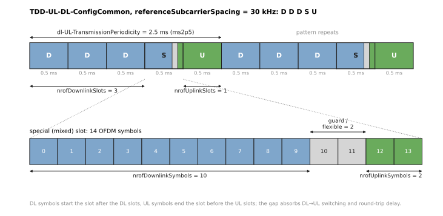
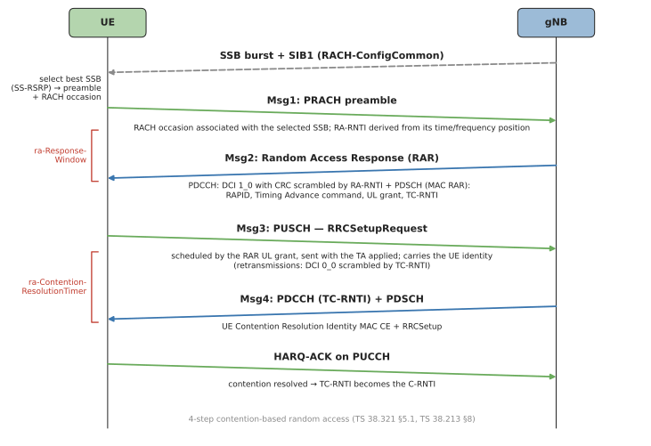
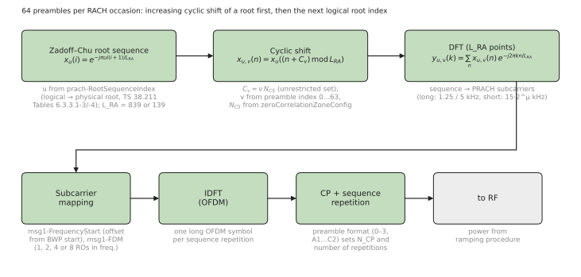
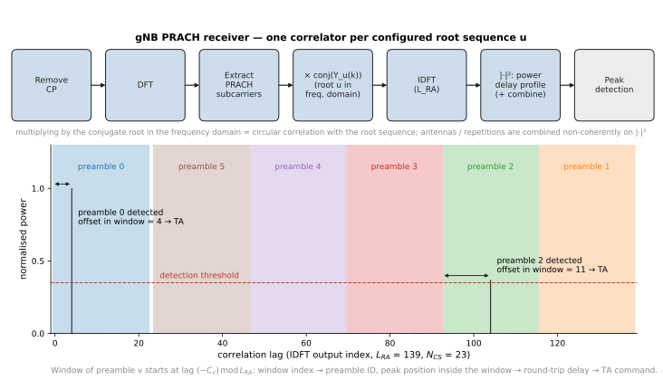
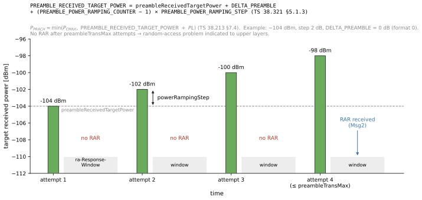
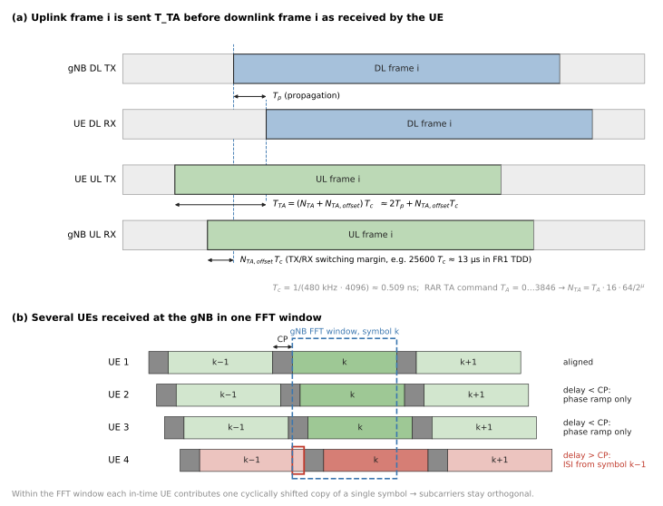
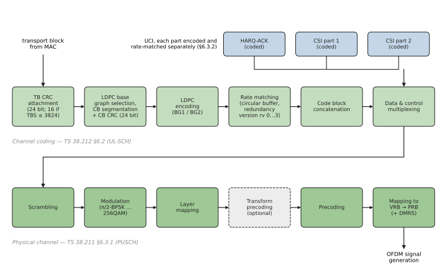
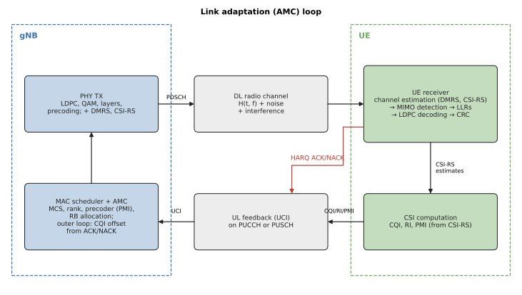

# Mobile Communication Systems (MobSys)

### Lecture 2 — Downlink data, random access and uplink procedures

Raymond Knopp, EURECOM

---

## Outline of basic 5G (and a bit of 4G) procedures

- Visit the procedures via the connection of a call from the perspective of the UE (User Equipment)
- Basic exchanges at the physical layer
  - Synchronization and broadcast channels
  - Random access
- Steady-state procedures
  - Downlink: Downlink Control Information (DCI) for scheduling control, downlink data transmission
  - Uplink: Uplink Control Information (UCI) for feedback, uplink data transmission

---

## What we will learn

- The time-frequency grid and 5G numerologies
- The notion of physical channels
- The roles of the different channels in the establishment and maintenance of a connection to the network

---

## PDSCH (Physical Downlink Shared Channel) (1)

- Main workhorse for transmitting DL information (control and user-plane data)
- Comprises many different transmission formats
  - Low to high spectral efficiency through adaptive modulation
  - Potential for spatio-frequency-time coding: beamforming, superposition coding (MIMO)

---

## PDSCH (Physical Downlink Shared Channel) (2)

The downlink physical-layer processing of transport channels consists of the following steps:

- Transport block CRC attachment
- Code block segmentation and code block CRC attachment
- Channel coding: LDPC coding
- Physical-layer hybrid-ARQ processing
- Rate matching
- Scrambling
- Modulation: QPSK, 16QAM, 64QAM and 256QAM (1024QAM from Rel-17)
- Layer mapping
- Mapping to assigned resources and antenna ports

---

## PDSCH: DMRS + CSI-RS
<!-- CHANGED: CSI-RS measures the channel as seen through the CSI-RS ports (which may themselves be beamformed), not necessarily the "real" raw channel -->

- The PDSCH has 2 associated reference signals
- **DMRS** (DeModulation Reference Signal)
  - Used by the receiver in the UE to estimate the channel that is used by the PDSCH
  - Channel = propagation channel AND gNodeB beamforming, i.e. the UE knows that the beamforming applied by the gNodeB on the PDSCH is the same as that applied on the DMRS
  - One set of orthogonal resources per logical antenna port
- **CSI-RS** (Channel State Information Reference Signal)
  - Used by the receiver in the UE to estimate the channel seen on the CSI-RS ports (close to the "real" channel, before PDSCH precoding)
  - Used to feed the scheduler + beamforming algorithms in the gNodeB via feedback channels on the UL

---

## DLSCH (Downlink Shared Channel)

- The transport channel that uses the PDSCH (this is the interface with the MAC layer)
- The DL-SCH is characterised by
  - support for HARQ
  - support for dynamic link adaptation by varying the modulation, coding and transmit power
  - possibility to be broadcast in the entire cell
  - possibility to use beamforming
  - support for both dynamic and semi-static resource allocation
  - support for UE discontinuous reception (DRX) to enable UE power saving

---

## HARQ

- HARQ is a cross-layer mechanism for the PDSCH
  - L2 (MAC) controls the retransmissions of DLSCH transport blocks based on low-layer signaling conveyed on the UL (via either PUCCH or PUSCH)
  - With each retransmission L2 can change
    - the redundancy version (instruction to the channel encoder/decoder)
    - the number of PRBs
    - the modulation order
  - Adaptive modulation via HARQ can reduce latency after the first failed transmission: "push the packet through by force"
- L1 uses a different code sequence for the same data for each redundancy version
  - Incremental redundancy, coupled with the LDPC channel code (RV order 0, 2, 3, 1)

---

## PDSCH Config Common

- SIB1 configures the common signaling formats for the PDSCH, used for all communications common to all UEs in the cell (i.e. not a dedicated configuration)
- In particular the allowable time-domain allocations, in a list called **pdsch-TimeDomainAllocationList** (up to 16 entries; if absent, default table TS 38.214 Table 5.1.2.1.1-2)
- The DCI which schedules a particular DLSCH/PDSCH contains an index pointing to one of the entries of this list. There are 3 parameters
  - **k0**: the offset of the PDSCH in slots with respect to the DCI that scheduled it
  - **mappingType** (A or B): the format of the DMRS mapping, which controls the channel estimation (type A: DMRS at symbol 2 or 3 of the slot; type B: DMRS at the first PDSCH symbol)
  - **startSymbolAndLength**: an encoding of the temporal allocation of the PDSCH called the **SLIV**

---

## Start and Length Indicator Value (SLIV)
<!-- NEW: review -->

TS 38.214 §5.1.2.1 — start symbol $S$ and length $L$ (in symbols) relative to the start of the slot:

$$
SLIV = \begin{cases} 14\,(L-1) + S & \text{if } (L-1) \le 7 \\ 14\,(14-L+1) + (14-1-S) & \text{otherwise} \end{cases}
\qquad 0 < L \le 14 - S
$$

- Decoding: let $a = \lfloor SLIV/14 \rfloor$, $b = SLIV \bmod 14$
  - if $a + b < 14$: $L = a+1$, $S = b$
  - else: $L = 14 - a + 1$, $S = 13 - b$
- Example: $SLIV = 40$ → $a=2$, $b=12$, $a+b \ge 14$ → $L=13$, $S=1$
- The same encoding is used for the PUSCH (pusch-TimeDomainAllocationList)

---

## Where we are

- DL synchronization channels (SSB)
- PDCCH (DCI) for scheduling information
  - Standalone: uses the initial BWP
- PDSCH for transmitting DL data (until now only control signaling for System Information – standalone)
  - Uses the initial BWP
- System Information (standalone) or 4G RRC (non-standalone) provide the radio configuration for UL transmission and the initial DL configuration
- Uplink now ready

---

## TDD configuration

- The information element **tdd-UL-DL-ConfigurationCommon** indicates an explicit TDD configuration
  - If absent, it indicates either FDD or a fully flexible scheduling of uplink and downlink
- Parameters (pattern1, optionally pattern2, with a referenceSubcarrierSpacing)
  - **dl-UL-TransmissionPeriodicity**: the period of the DL/UL pattern (0.5 … 10 ms)
  - **nrofDownlinkSlots**: the number of full DL slots
  - **nrofDownlinkSymbols**: the number of DL symbols in the "mixed" slot
  - **nrofUplinkSlots**: the number of full UL slots
  - **nrofUplinkSymbols**: the number of UL symbols in the "mixed" slot
- The number of "guard" symbols is 14 − nrofDownlinkSymbols − nrofUplinkSymbols
- Patterns are typically written like DDDSU (period of 5 slots, 3 DL slots, 1 mixed slot, 1 UL slot). "S" means "special", the old LTE (4G) terminology; in 5G these are called "mixed"

---

## Uplink physical channels

- Uplink physical channels
  - Physical Uplink Shared Channel (PUSCH): uplink data and/or feedback information for the gNB scheduler
  - Physical Uplink Control Channel (PUCCH): feedback information for the gNB scheduler
  - Physical Random Access Channel (PRACH): preambles for association
- Signals
  - DeModulation Reference Signal (DMRS): for UL channel estimation in resources corresponding to PUSCH and PUCCH
  - Sounding Reference Signal (SRS): UL channel sounding (scheduling, beamforming with reciprocity)
  - PTRS (Phase-Tracking Reference Signal): phase-noise tracking, mostly FR2

---

## Random-access procedures (1)
<!-- CHANGED: the RAR is carried on PDSCH (it schedules Msg3 on PUSCH); PRACH configuration comes from SIB1 (rach-ConfigCommon), not BCH -->

- During association, the PHY is responsible for the transmission of
  - the random access preamble (Msg1, on PRACH): number in 0…63 chosen by the UE MAC
  - the Msg3 PUSCH scheduled by the random access response grant (RAR, Msg2, received on PDSCH)
- The UE receives the PRACH configuration and root sequences from SIB1 (rach-ConfigCommon), which allows it to generate the PRACH
- Msg4 (contention resolution) on PDSCH, acknowledged on PUCCH

---

## Random-access procedures (2)

- PRACH comprises a variable number of PRBs in one or a set of consecutive slots/subframes reserved for random-access preambles
- It does not always use the same time/frequency grid as PUSCH/PDSCH! (it can have a small subcarrier spacing for large cells)
- Note: the gNB can decide to schedule PUSCH for other users during PRACH slots (outside the PRACH PRBs)

---

## rach-ConfigGeneric
<!-- CHANGED: there is no "Dx" PRACH format; parameter name is preambleReceivedTargetPower -->

This information element configures the parameters for the random-access procedure

- **prach-ConfigurationIndex**: index into one of 3 tables (FDD, TDD FR1, TDD FR2) giving the preamble format (0, 1, 2, 3, A1…A3, B1…B4, C0, C2) and the temporal allocation and multiplexing
- Frequency allocation: frequency multiplexing **msg1-FDM** (1, 2, 4, 8 occasions) and frequency start **msg1-FrequencyStart**
- Detection windows and number of sequences: $N_{CS}$ index, **zeroCorrelationZoneConfig**
- Power ramping parameters: target RX power **preambleReceivedTargetPower**, step size **powerRampingStep**, number of transmissions **preambleTransMax**
- Random access response window: **ra-ResponseWindow** (in slots, at most 10 ms)
- And a few others

---

## prach-ConfigurationIndex
<!-- NEW: review -->

- Integer 0…255, index into TS 38.211 Table 6.3.3.2-2 (FR1 FDD/SUL), 6.3.3.2-3 (FR1 TDD), 6.3.3.2-4 (FR2 TDD)
- Each row gives
  - the preamble format
  - the frames carrying PRACH: $n_{SFN} \bmod x = y$
  - the subframe numbers (FR1) or 60 kHz slot numbers (FR2) carrying PRACH
  - the starting OFDM symbol
  - the number of PRACH slots within a subframe / 60 kHz slot
  - the number of time-domain PRACH occasions within a PRACH slot, and the PRACH duration (in symbols)
- In TDD, the gNB must choose an index whose PRACH occasions fall into UL slots/symbols of the TDD pattern

---

## PRACH formats
<!-- NEW: review -->

TS 38.211 §6.3.3.1, Tables 6.3.3.1-1 and 6.3.3.1-2; Zadoff-Chu sequences

- **Long sequences, $L_{RA} = 839$** (FR1 only)
  - Format 0: 1.25 kHz, 1 sequence, ≈1 ms, cell radius ≈ 15 km
  - Format 1: 1.25 kHz, 2 repetitions, 3 ms, ≈ 100 km
  - Format 2: 1.25 kHz, 4 repetitions, 3.5 ms, ≈ 22 km (coverage)
  - Format 3: 5 kHz, 4 repetitions, 1 ms, ≈ 15 km (high speed)
- **Short sequences, $L_{RA} = 139$** (also 571/1151 from Rel-16), SCS = $15\cdot2^\mu$ kHz (15/30 FR1, 60/120 FR2)
  - A1, A2, A3 (2, 4, 6 symbols), B1…B4 (2, 4, 6, 12), C0, C2 (1, 4): A/B/C differ in CP vs. guard time
  - Fit inside a slot, several occasions per slot; small cells, beam sweeping in FR2
- Cyclic shifts $N_{CS}$ of a root give 64 preambles per occasion; more roots if needed

---

## PRACH transmitter
<!-- CHANGED: NR names (prach-RootSequenceIndex 0..837 / 0..137, rach-ConfigCommon, reconfigurationWithSync) replace LTE ones (1..838, prachConfigCommon, mobilityControlInfo) -->

- Preamble index from MAC (0…63) and **prach-RootSequenceIndex** (0…837 for $L=839$, 0…137 for $L=139$) from RRC rach-ConfigCommon, OR from RRC reconfigurationWithSync (dedicated RACH during handover)
- $N_{CS}$ from zeroCorrelationZoneConfig in rach-ConfigGeneric
- Generation: Zadoff-Chu root sequence → cyclic shift → $L$-point DFT (frequency-domain transform of the ZC preamble sequence) → mapping and frequency shift according to msg1-FrequencyStart → $N$-point IDFT → CP

---

## PRACH receiver (gNB, once per rootSequenceIndex)
<!-- CHANGED: eNB -> gNB; correlation IDFT size given as an implementation example -->

- $N$-point DFT of the received signal, extraction of the PRACH subcarriers
- Multiplication by the conjugate of the root sequence (frequency-domain correlation)
- IDFT (e.g. 1024 points for $L=839$) → power delay profile over all cyclic shifts
- Preamble detector: a peak in the window of cyclic shift 0, 1, 2, … indicates that the preamble is active (signal presence)
- The time offset within the cyclic shift window is used to determine the timing advance for the UE
- Tradeoff between the gNB PRACH detection procedure and the maximum cell radius ⇒ many cyclic shifts = short timing offset tolerance

---

## SSB configuration
<!-- CHANGED: explained the SIB1 encoding (inOneGroup + groupPresence) -->

The SSB is configured in SIB1 with

- **ssb-PositionsInBurst**: a double indicator
  - **inOneGroup**: an 8-bit mask of which SSB indexes are active in a group of 8 (FR1: only the first 4 bits used when $L_{max}=4$)
  - **groupPresence** (FR2 only): an 8-bit mask of which of the 8 groups are present
  - → up to 64 SSB indexes (64-bit mask) for FR2
- **ssb-PeriodicityServingCell**: the period of repetition of the SSB transmissions (5, 10, 20, 40, 80, 160 ms)

---

## SSB and RACH associations (1)

- The RACH and SSB have a deterministic relationship, so that the gNodeB knows which SSB the UE has received with the highest strength
- The parameters under **ssb-perRACH-OccasionAndCB-PreamblesPerSSB** provide this association
  - The first parameter, ssb-perRACH-Occasion ($N$), has values 1/8, 1/4, 1/2, 1, 2, 4, 8, 16
  - The second parameter, CB-PreamblesPerSSB ($R$), is the number of contention-based preambles that the UE can use per SSB (at most 64)
- RACH occasions occur in time and frequency, and these occasions are linked to SSB indexes: detection of a PRACH on a particular occasion and preamble index indicates the SSB that was received by the UE
- Mapping order: preamble index, then frequency occasion, then time occasion within a slot, then PRACH slots (TS 38.213 §8.1)

---

## SSB and RACH associations (2)
<!-- CHANGED: completed the truncated last sentence (N=1 and N<1 cases) -->

- The simplest configurations (e.g. formats 0–3) only have 1 PRACH occasion in time and frequency per PRACH slot, so the SSB is associated to the frame/slot where the PRACH is received
- Sometimes operators assign $N > 1$, which allows
  - Detection of more than one SSB per occasion, which speeds up the random-access procedure. But it implies being able to receive in multiple directions at the same time
  - The preamble space is split into different SSB zones. For instance if $N = 16$, there are 4 possible preambles per SSB index
- The simplest case is $N = 1$: one SSB per RACH occasion, and its $R$ preambles are all on that occasion
- With $N < 1$, one SSB is mapped to $1/N$ consecutive RACH occasions

---

## L1 random access
<!-- NEW: review -->
<!-- (original slide text kept; the missing power equation and RA-RNTI were added) -->

- PHY receives the preamble index, target power, RA-RNTI and PRACH resource from MAC
- Power is set to (TS 38.213 §7.4, TS 38.321 §5.1.3):

$$P_{PRACH} = \min\left(P_{CMAX},\; P_{PRACH,target} + PL\right)\ \text{[dBm]}$$

  with $PL$ the path loss estimated on the SSB, and $P_{PRACH,target}$ = PREAMBLE_RECEIVED_TARGET_POWER from MAC (next slides)
- The preamble is chosen using the index and transmitted
- The UE waits to detect a PDCCH with the indicated RA-RNTI (a temporary identifier during the RA procedure, verified with the CRC mask) and delivers the associated PDSCH to MAC if decoding is successful – **Msg2** or Random Access Response (RAR)
- $\text{RA-RNTI} = 1 + s_{id} + 14\,t_{id} + 14\cdot80\,f_{id} + 14\cdot80\cdot8\,c_{id}$ (first symbol, slot, frequency occasion, and carrier of the PRACH: $c_{id}$ is `ul_carrier_id`, 0 = normal UL, 1 = SUL)

---

## Power ramping (1)
<!-- NEW: review -->

TS 38.321 §5.1.4 (MAC) and TS 38.213 §7.4 (PHY):

$$
P_{target} = \text{preambleReceivedTargetPower} + \Delta_{PREAMBLE} + (\text{COUNTER}-1)\cdot\text{powerRampingStep}
$$

$$P_{PRACH} = \min\left(P_{CMAX},\ P_{target} + PL\right)$$

- $P_{target}$ is the MAC variable `PREAMBLE_RECEIVED_TARGET_POWER`
- COUNTER = `PREAMBLE_POWER_RAMPING_COUNTER`, starts at 1
- $\Delta_{PREAMBLE}$: format-dependent offset (TS 38.321 Table 7.3-1)
- powerRampingStep ∈ {0, 2, 4, 6} dB; preambleReceivedTargetPower ∈ −202…−60 dBm (2 dB steps)

---

## Power ramping (2)

- The UE computes the propagation path loss based on the signaled gNodeB transmit power (ss-PBCH-BlockPower) and its SSB measurement
- Based on this it computes its own transmit power for PRACH, so that the gNodeB receives it at preambleReceivedTargetPower
- The UE retransmits up to preambleTransMax − 1 times until it detects a RAR (Msg2), incrementing its power by powerRampingStep before each retransmission
  - Each attempt: Msg1, then wait ra-ResponseWindow for the RAR
  - The counter is not incremented if the UE changes the selected SSB (beam) between attempts

---

## ss-PBCH-BlockPower
<!-- NEW: review -->

- In ServingCellConfigCommonSIB (SIB1), range −60…50 dBm
- Definition: average EPRE (energy per resource element) of the REs that carry the SSS, in dBm
  - Per RE, not total: the whole SSB (240 subcarriers) is ≈ 10·log10(240) ≈ 23.8 dB higher
- Used by the UE for path loss estimation (TS 38.213 §7.4, §7.1.1):

$$PL = \text{ss-PBCH-BlockPower} - \text{SS-RSRP (higher-layer filtered)}$$

- This $PL$ is used for PRACH, Msg3 PUSCH and PUCCH power control before dedicated path loss reference signals are configured

---

## Random access: timing
<!-- CHANGED: original 4/5/6-subframe values are LTE (TS 36.213); replaced with NR rules of TS 38.213 §8 -->

- After transmission of the PRACH preamble, the UE monitors PDCCH during the random access response window (ra-ResponseWindow), and 3 outcomes are possible
  - At the end of the window, if no response is received (or correctly decoded) on PDCCH, the UE PHY must be ready to re-transmit a PRACH no later than $N_{T,1}$ + 0.75 ms after the end of the window, upon request by higher layers
  - If the random-access response is received within the window but the payload does not contain a response to the transmitted preamble, the UE PHY must be ready to re-transmit no later than $N_{T,1}$ + 0.75 ms after the end of the RAR PDSCH, upon request by higher layers
  - If a RAR for its preamble is received in slot $n$, the UE transmits Msg3 on PUSCH in slot $n + k_2 + \Delta$, where $k_2$ comes from the time resource allocation in the RAR grant and $\Delta$ = 2, 3, 4, 6 slots for $\mu$ = 0, 1, 2, 3 (TS 38.214 Table 6.1.2.1.1-5)
- $N_{T,1}$: PDSCH processing time (TS 38.214 §5.3)

---

## Random Access Response grant (RAR grant)
<!-- NEW: review -->

- The MAC RAR (7 bytes) from the gNB MAC comprises: R (1 bit), Timing Advance Command (12 bits), **UL grant (27 bits)**, Temporary C-RNTI (16 bits)
- RAR UL grant fields (TS 38.213 Table 8.2-1):

| Field | Bits |
|---|---|
| Frequency hopping flag | 1 |
| PUSCH frequency resource allocation | 14 |
| PUSCH time resource allocation | 4 |
| MCS | 4 |
| TPC command for PUSCH | 3 |
| CSI request | 1 |
| **Total** | **27** |

- The time resource allocation is an index into pusch-TimeDomainAllocationList (k2, SLIV)
- Rel-16 NR-U adds a 2-bit ChannelAccess-CPext field (29 bits in shared spectrum)

---

## Timing adjustments

- The need for timing advance is fundamental in SC-FDMA/OFDMA systems (even FDD)
- Multiple-access nature of the channel and requirement for orthogonality between users. This is because the users' signals overlap in time, but not in frequency (unless SDMA is performed on the uplink). Orthogonality ensures
  - that no inter-user interference is present
  - that the gNB can use a common time reference for detection of all users
- Timing adjustments are required to follow the mobility of the UE
- If the timing difference plus the channel duration (delay spread) is less than the cyclic-prefix length, then orthogonality is maintained

---

## Need for timing advance
<!-- NEW: review -->

- OFDM/SC-FDMA transmissions must be roughly synchronous at the gNB
  - Superposition of 3 users in the time domain at the gNB receiver, with a single synchronization point (FFT window) of the gNB RX
  - There is an uncertainty in symbol timing of the UE signals: a UE at distance $d$ arrives $2d/c$ late (it is synchronized on a DL that is already $d/c$ late)
- The asynchronism is absorbed by the prefix at the gNB, as long as residual misalignment + delay spread < CP
  - e.g. at 30 kHz SCS the CP is ≈ 2.34 µs ↔ ≈ 350 m of distance: far too small without timing advance

---

## Timing advance (1)
<!-- CHANGED: NR values (12-bit T_A 0..3846 in RAR, step 16*64/2^mu T_c) replace LTE values (11 bits, 0..1282, fixed 520.83 ns) -->

- The UE receives timing advance commands from the gNB and adjusts its timing for PUCCH/PUSCH/SRS transmissions
- It is a measure in multiples of $16\cdot64\,T_c/2^\mu$: 520.83 ns at 15 kHz (16 samples at 30.72 Ms/s, 1/9 of the cyclic prefix duration), 260.4 ns at 30 kHz
- Random-access phase
  - The UE receives a 12-bit command in the RAR: $T_A = 0 \dots 3846$, $N_{TA} = T_A\cdot16\cdot64/2^\mu$ (0–2 ms at 15 kHz, i.e. up to ≈ 300 km cell radius; the PRACH format limits it further)
  - Here the initial delay (due to propagation) is absorbed at the gNB by the cyclic structure and guard time of the PRACH and used to compute the offset sent in the RAR

---

## Timing advance (2)
<!-- CHANGED: NR application time is slot n+k+1 (TS 38.213 §4.2), original "n+6" was LTE -->

- Steady state
  - Received through gNB MAC signaling (Timing Advance Command MAC CE, 6 bits): $N_{TA,new} = N_{TA,old} + (T_A - 31)\cdot16\cdot64/2^\mu$ (differential)
  - A command received in slot $n$ is applied from the beginning of UL slot $n+k+1$, with $k = \lceil N_{slot}^{subframe,\mu}(N_{T,1} + N_{T,2} + N_{TA,max} + 0.5\,\text{ms})/1\,\text{ms} \rceil$
- Changes applied affect the signal in the later slot only, not the earlier one
  - Timing advance increased: transmissions in slots $n+k$ and $n+k+1$ overlap → the UE completes slot $n+k$ and the overlapping samples at the start of slot $n+k+1$ are lost
  - Timing advance decreased (timing delay): a gap of a few samples appears before slot $n+k+1$ (gained samples)

---

## Back to the story … PUSCH

- Now we have to describe the ULSCH/PUSCH
- The ULSCH is coded similarly to the DLSCH, comprising
  - LDPC coding
  - Rate matching
  - Incremental redundancy
- It can use DFT precoding (SC-FDMA) or just regular OFDM
  - SC-FDMA can be better for coverage in long-range networks (lower PAPR)
  - OFDM is more suited for small cells (and MIMO)
  - Configurable per UE anyway
- BUT it also contains PHY control information (UCI) for feedback to the gNB

---

## ULSCH coding chain
<!-- NEW: review -->

- Data: TB CRC → code block segmentation → LDPC → rate matching → code block concatenation
- Control information (UCI) multiplexed on PUSCH, separately coded (polar or small block codes) with its own rate (beta offsets):
  - HARQ ACK/NAK
  - CSI part 1 (e.g. CQI, RI – the MIMO rank)
  - CSI part 2 (e.g. PMI)
- UCI is mapped first, close to the DMRS symbols; data is rate-matched around it (or punctured by ACK when ≤ 2 bits)
- Then scrambling, modulation, (transform precoding), mapping

---

## pusch-ConfigCommon
<!-- CHANGED: Msg3 power description made more precise -->

- The PUSCH has an allocation list (**pusch-TimeDomainAllocationList**) which provides the possibilities for temporal resources – SLIV (startSymbolAndLength) – encoded as for the PDSCH
- Each entry also has a parameter **k2**, the number of slots between the DCI that schedules the PUSCH transmission and the transmission itself
- Power control
  - **msg3-DeltaPreamble** ∈ {−1, 0, …, 6} sets the power of the first PUSCH transmission (Msg3 of the RA procedure): its target received power is preambleReceivedTargetPower + 2·msg3-DeltaPreamble dB, on top of which the total PRACH power ramp-up and the RAR TPC are added
  - **p0-NominalWithGrant** (−202…24 dBm) is the target received power of the PUSCH when it is scheduled by DCI or RAR. In the steady state, there are also dynamic power control increments, controlled by the DCI sent by the gNodeB, on top of this fixed value

---

## Physical Uplink Control Channel (PUCCH) (1)

- PUCCH is used to convey basic control information in the absence of PUSCH allocations
- Occupies minimal resources (often 1 PRB) but can grow for payloads of up to a hundred bits or more (more usual sizes are around 11–22 bits for CQI)
- Primary functions are
  - Scheduling Request (on periodic SR occasions)
  - ACK/NAK for DLSCH/PDSCH, usually 1 or 2 bits, but in some cases many more (TDD slots + MIMO + carrier aggregation)
  - Periodic CSI reporting, up to tens of bits

---

## Physical Uplink Control Channel (PUCCH) (2)

Formats (TS 38.211 §6.3.2, TS 38.213 §9)

- **0**: up to 2 bits ACK/NAK + 1 bit scheduling request; 1 or 2 OFDM symbols, 1 PRB; not for coverage-limited scenarios
- **1**: 1–2 bits ACK/NAK (+ SR); 4–14 symbols, 1 PRB; good for coverage
- **2**: more than 2 bits, up to hundreds of bits; 1 or 2 OFDM symbols, multiple PRBs (up to 16); not for coverage-limited scenarios ⇒ small-cell scenarios
- **3**: more than 2 bits, up to hundreds of bits; 4–14 symbols, 1 or more PRBs (DFT-s-OFDM); good for coverage
- **4**: moderate payload; 4–14 symbols, 1 PRB, multiple UEs (orthogonal cover codes); good for coverage

---

## PUCCH (format 1)

- BPSK or QPSK symbol (1 or 2 bits) multiplied by a low-PAPR length-12 sequence (cyclic shift), then spread in time by an orthogonal cover code: a spread-spectrum signal
- PUCCH DMRS (same structure, without data) on alternate symbols
- Several UEs share the same PRB through different cyclic shifts / cover codes
- Optional intra-slot frequency hopping: maximal frequency separation (band edges) for diversity

---

## pucch-ConfigCommon

- This field configures the simplest PUCCH, for ACK/NAK of the common signals
  - The first DL packet requiring ACK/NAK, called Msg4, and its retransmissions
  - Also other transmissions of DL CCCH until the DCCH is configured, along with the UE-specific configurations for DL and UL which are received in Msg4 (piggy-backed RRCSetup) or in subsequent CCCH transmissions after Msg4 and completion of the random-access procedure
- Only a few parameters
  - **pucch-ResourceCommon** (0…15): index into TS 38.213 Table 9.2.1-1 (PUCCH format 0 or 1, first symbol, number of symbols, PRB offset, set of initial cyclic shifts)
  - **pucch-GroupHopping**: a randomization parameter for the PHY layer
  - **hoppingId** (0…1023): the seed for the hopping sequence
  - **p0-nominal** (−202…24 dBm): power control received power target

---

## CSI reporting (1)

- CSI reporting serves several purposes
  - Drive the gNB scheduler performing resource allocation: the gNB gets broadband (and sub-band) measurements and can optimize the spectral allocation
  - Provide stimulus for the gNB AMC algorithm, by allowing the gNB to control the spectral efficiency and the error rates/delay seen by the UE
  - Provide rank indications of the spatio-frequency-temporal channel for MIMO mode selection
  - Provide precoding information for (MU-)MIMO

---

## CSI reporting (2)
<!-- CHANGED: added semi-persistent reporting; "8 ms" round trip is the LTE value, NR can be a few slots -->

- CSI reports can be periodic, semi-persistent or aperiodic, as configured by the gNB
  - Periodic on PUCCH
  - Semi-persistent on PUCCH or PUSCH
  - Aperiodic, along with data on PUSCH (triggered by the CSI request field in the UL DCI)
- Round-trip times for feedback are a few ms (8 ms in LTE, a few slots in NR)
- AMC is possible (and effective) for slow mobile speeds (< 10 km/h)
<!-- CHECK: "< 10 km/h" depends on carrier frequency (coherence time ~ 1/Doppler); keep as rule of thumb for 3.5 GHz? -->

---

## AMC

- Adaptive Modulation and Coding loop: gNB TX → DL channel → UE inner RX → channel decoder (LLRs) → CSI/RI/PMI algorithms → UL feedback → gNB RX → AMC algorithm → gNB TX
- All units in the UE receiver contribute to the CQI/RI/PMI determination
- The gNB AMC algorithm combines CSI with HARQ ACK/NAK statistics (outer loop) to select the MCS, rank and precoder

---

## Periodic CSI reporting
<!-- CHANGED: NR has no UE-selected sub-band reporting (LTE); periodicity is 4..320 slots -->

- Reports scheduled on PUCCH
- Wideband or sub-band CSI, and beam reports (L1-RSRP with SSB/CSI-RS resource index)
- The type of signaling is configured by gNB RRC (CSI-ReportConfig)
- The period of reporting is configurable: 4 to 320 slots (e.g. 4 slots = 1 ms at 60 kHz, 2 ms at 30 kHz)

---

## Scheduling process (gNB perspective) (1)

- Determine which UEs should be granted resources on the uplink (based on information from SRS and queuing feedback – buffer status reports) and what resources to grant
- Determine which UEs should be granted resources on the downlink (based on CQI, RI, and local queuing information)
- Identify common control channel messages for formats 2_x (TPC)
- For each message, decide on the PDCCH aggregation level (1, 2, 4, 8 or 16 CCEs), and any power offset to be applied
- Determine how many PDCCH resources (in terms of CCEs) will be required

---

## Scheduling process (gNB perspective) (2)
<!-- CHANGED: in NR the CORESET duration is RRC-configured (no PCFICH), so the PDCCH symbol count cannot be increased dynamically as in LTE -->

- If any PDCCH cannot be mapped to a CCE location (no more room)
  - Use another CORESET/search space or a lower aggregation level (if possible); in LTE: increase the OFDM symbol count for the PDCCH
  - Drop some DLSCH/ULSCH allocations (lowest priority)
- Allocate resources to PDCCHs
- Check powers
- Transmit
